# Databricks Reference Architecture

An interactive, exportable reference architecture for the Databricks Data + AI
Platform, specialised for seventy industries on Azure, AWS and GCP. No build step
and no backend: a static folder that lazy-loads its industry boards, translations
and reference data as plain files, translates into sixteen languages, shows which
products each cloud region can run, and exports to PDF, PowerPoint, PNG, GIF, a
standalone HTML copy, and editable files for draw.io, Lucidchart, Visio, Miro,
Figma and Excalidraw. Serve it locally, or deploy it into your own Databricks
workspace as an app your teams reach from the workspace navigation.

**[Open the live board](https://databricks-industry-solutions.github.io/databricks-reference-architecture/)**

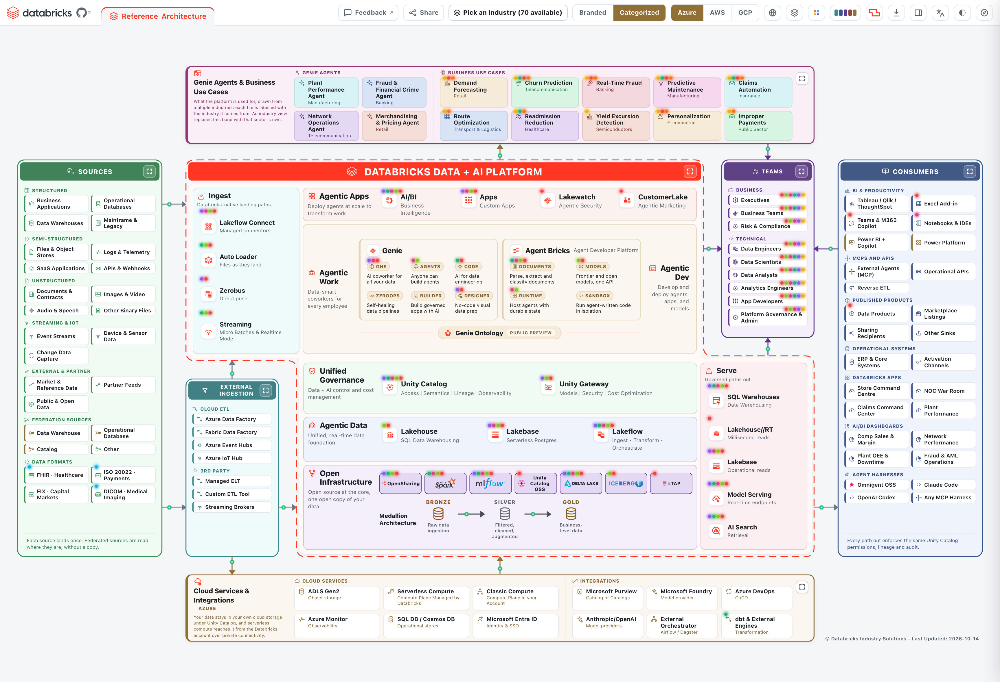

---

## What it is

Most reference architectures are a picture. Someone drew it in a diagramming
tool, exported a PNG, and pasted it into a deck. It is accurate on the day it is
made, it cannot be interrogated, and adapting it to a specific customer means
starting again in the source tool, which nobody has.

Databricks Reference Architecture is the same architecture as a live document:

- **Every box is a real product**, and clicking it opens what it is, what a
  customer would not learn from the name, its release stage, the regions it runs
  in, the documentation for the cloud you are on, the product page, and related
  boxes you can jump to.
- **The cloud provider is a switch.** Azure, AWS and GCP swap the storage,
  compute, identity and ingestion services, and every documentation link
  re-points at that cloud's own docs.
- **The platform is drawn in five shapes**, so the same architecture fits a
  16:9 slide, a portrait page, or a layout that has to leave room for a third
  party in the middle.
- **Release stage is a filter.** Show GA only for a procurement conversation, or
  add Beta and the previews for a roadmap one.
- **Region is a filter too.** Pick the cloud region a customer deploys in and the
  board dims every product that region cannot run yet, taken from the public
  Databricks docs, so nobody pitches what is not available there.
- **Industry is a switch too.** Seventy industries, each one specialising the
  sources, ingestion, teams, apps, use cases and consumers, with the medallion
  layers pointing at that industry's own data model. Every use case and every
  team is a story you can open: click a use case for the problem it solves, who
  benefits, how it is built, the components it uses and the customer stories that
  prove it; click a team for its sub-personas and the use cases they care about.
- **The flows are alive.** Every connector is a solid arrow with a glowing dot
  gliding from source to target, and all the dots move in step, so the board reads
  as data in motion rather than a static picture. The motion pauses after a minute
  without input or while the tab is hidden, follows the reduced-motion setting,
  and is captured in the GIF export too.
- **Highlights show what is behind a box.** Glowing corner dots mark the boxes
  that carry a customer story, a data connector, a product tour, a demo, a free
  Academy course, a certification, a video or a solution accelerator, one colour
  per kind, so you can scan the board for one kind of resource at a glance.
- **A guided tour** walks a first-time viewer through every control and every
  zone, and opens the detail panel on a real box so they see what a click gives
  them. It runs itself once on a first visit and replays any time from the tour
  button at the end of the toolbar.
- **It speaks sixteen languages.** A language switch translates the board content
  into any of sixteen languages, right-to-left for Arabic and Hebrew, while the
  toolbar stays in English and product and brand names are never translated. Each
  language is fetched only when it is picked.
- **Every board has a share card.** A share button posts the board straight to
  LinkedIn, X, Reddit and more, and every industry has its own Open Graph preview
  image, so a pasted link unfurls in Slack, Teams or a social feed with a picture
  and title tailored to that industry rather than a bare URL.
- **It exports, and the export points back.** PDF and PowerPoint open on a cover
  carrying the title and a link to the exact live board the file was made from,
  then an index of the sections, the architecture, and one detailed page or slide
  per item across four sections: *Use Cases*, *Genie Agents*, *AI/BI Dashboards*
  and *Databricks Apps*, each carrying the same detail the on-screen drawer shows,
  and a closing slide that links back to the platform and the live board. The deck
  follows the theme and the Branded/Categorized choice on screen, so a categorized
  dark board exports a categorized dark deck. Plus PNG and an animated GIF that
  keeps the flow moving, both on a transparent background, and a standalone HTML
  copy.

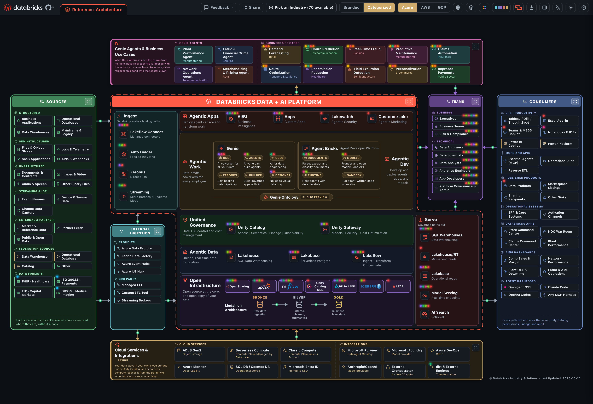

---

## Why it is useful

### 1. See the whole of Databricks, and where it fits your architecture

Most people meet Databricks one feature at a time: a notebook here, a job there,
Unity Catalog in a governance review. This board puts the entire Data + AI
Platform in one frame: the sources on the left; ingestion, the
medallion layers, unified governance and the agentic layers through the middle;
and the consumers, the teams and the cloud services around the outside, with the
data flows drawn as live arrows so you can see how one part feeds the next. Every
box is a real product, not a label, so clicking one tells you what it is, the
thing the name does not give away, what it actually does, and the boxes it
connects to. In one screen a newcomer gets the shape of the whole platform, and
an architect gets the connections between its parts.

It is not a generic diagram either, and that is the point. The cloud switch
redraws the storage, compute, identity and ingestion services as Azure, AWS or
GCP and re-points every documentation link at that cloud, so you are looking at
the platform on the cloud you actually run, and the region filter dims what the
region you deploy in cannot run yet. The industry switch respecialises the
sources, teams, use cases and consumers for your sector and points the medallion
layers at that industry's own data model. And when you need it tied to one
specific estate, edit mode, the YAML export and import, and the AI assistant let
you retarget the board to a particular customer or use case and export it, as a
PDF, a PowerPoint or a standalone page, that shows exactly how Databricks fits
into that architecture. It is the difference between a picture of the platform
and a picture of *your* platform.

### 2. Learn the whole platform, not just present it

Because every box carries its own facts and links, the board doubles as a way to
learn Databricks rather than only to show it. Open any product and the **Learn
more** section takes you to the cloud-specific documentation for the cloud you are
on (the Azure Databricks docs on Azure, `docs.databricks.com` on AWS and GCP),
the product page, and a blog or deep dive, so each box is a launch point into the
official material rather than a dead end. The same panel lists the product tours
and demos, the free Databricks Academy courses and the certifications that cover
the product, and every team panel gathers the courses and credentials for that
role. The release-stage filter teaches what is
generally available today against what is still in preview or beta. The use cases
spell out the problem each one solves, who benefits, how it is built and which
components it touches, with links to real customer stories, so you see how the
features are used and not only what they are named. The Genie Agents and AI/BI
dashboards show the question-and-answer layer that sits on top. There is a
**Databricks YouTube channel** section with curated videos verified against the
official channel for when you would rather watch than read, and the whole board
translates into sixteen languages, so a team can learn in its own. A new joiner, a
partner or a customer can explore the platform at their own pace, from the first
box to the deepest link, without a slide deck in between.

---

## What it shows

Sources on the left, the platform through the middle, consumers on the right,
with the teams who use it and the cloud it runs on wrapped around the outside.

| Zone | What sits there |
|---|---|
| **Sources** | Structured, semi-structured, unstructured, streaming and IoT, external and partner data, federation sources reached without copying, and the data formats the industry exchanges (FHIR, ISO 20022, FIX, DICOM and more), each linked to its standard |
| **Cloud and 3rd-party ingestion** | The cloud's own ETL services, and third-party ELT and streaming brokers that land data alongside the platform's native ingestion |
| **Platform** | Ingest, Agentic Apps, Agentic Work, Agentic Dev, Unified Governance, Agentic Data, Open Infrastructure with the medallion layers, and Serve, drawn as one outline traced by a moving ring |
| **Teams** | The business and technical teams the platform is built for. A tile is a team, never a job title, and the roles inside it and the surfaces they touch are in the side panel |
| **Consumers** | BI and productivity tools, MCP and APIs, published data products, operational systems, four **AI/BI Dashboards** and four **Databricks Apps**, and the agent harnesses that arrive from outside |
| **Use cases and Genie Agents** | What the platform is used for, in the band above the platform: ten use cases and four Genie Agents on every board. On the reference board they are drawn from several industries, each labelled with the one it comes from; an industry board replaces them with that sector's own |
| **Cloud services and integrations** | The account's own storage, serverless and classic compute, operational databases, identity and observability, and the integrations around them: the cloud's catalog, model providers, CI/CD, an external orchestrator and external engines |

### How to read it

| Signal | Meaning |
|---|---|
| **Solid arrow** | Data moves along it, and a glowing dot glides from source to target in the direction it actually flows. Every dot moves in step with the others |
| **Dashed zone outline** | A grouping, not a boundary that data crosses |
| **The ring around the platform** | One continuous outline: the platform is one product, not a stack of separate ones |
| **Colour** | Identifies the zone, never the status. Every zone keeps its own hue in every palette and both themes |
| **Coloured corner dots** | What a box carries: a customer story, a data connector, a product tour, a demo, a free Academy course, a certification, a video or a solution accelerator. The Highlights menu names each colour |
| **Dimmed box** | A product the region picked in the Region menu cannot run yet |

---

## The controls

Fifteen controls, left to right, sitting in the header above the diagram, plus
platform zoom on the diagram itself. The GitHub mark beside the Databricks logo
opens this repository, and **Edit** beside the *Reference Architecture* tab clones
the board into a tab of your own (see [Tabs](#tabs)).

| Control | What it does |
|---|---|
| **Feedback** | Opens a short form in a new tab, for feedback on an architecture, general feedback, or a request for a new industry |
| **Share** | Posts the board on screen to LinkedIn, X, Facebook, Reddit, Hacker News, WhatsApp, Telegram or email, or copies the link; the link points straight to the industry showing, and unfurls with that industry's own preview card |
| **Industry** | Seventy industries plus *Standard Reference Architecture*, searchable, every entry on one line. Specialises everything outside the platform: sources, ingestion, teams, apps, use cases and consumers. The platform itself and the cloud services band do not change |
| **Display: Branded / Categorized** | Shows every product by its commercial brand name (*Branded*), or rooted back to its generic category (*Categorized*, the default) for a room that knows the category but not the product, so SABRE reads as *Airline Reservation System*. The choice applies everywhere at once, the tiles, the detail drawers and every download, and it is remembered between visits |
| **Cloud** | Azure, AWS, GCP. Swaps the cloud services band, the cloud ETL tiles and the federation sources, and re-points every documentation link at that cloud's own docs, including the Microsoft Learn pages on Azure |
| **Region** | Picks one of the cloud's supported regions, searchable by code or location. The board dims every product that region cannot run yet; *All regions* clears it (see [Region](#region-what-each-region-can-run)) |
| **Stage** | Filters the platform box by release stage |
| **Highlights** | Switches the corner dots on and off by kind, with the number of boxes carrying each kind; *All highlights* toggles them together (see [Highlights](#highlights-what-is-behind-each-box)) |
| **Palette** | Thirteen colour schemes in three groups |
| **Style** | Five platform shapes |
| **Download** | PDF, PowerPoint with an editable appendix, PNG, GIF, HTML, and editable draw.io, Visio, SVG and Excalidraw files. Its *Architecture descriptor* section exports the board on screen, the reference or any industry, as an editable YAML file, and imports one back to open your own version in a new tab |
| **Details panel dock** | Pins the detail drawer to the side so it stays open while you click from box to box, instead of overlaying the board each time |
| **Language** | Translates the board content into any of sixteen languages, right-to-left for Arabic and Hebrew. The toolbar and menus stay in English, and product and brand names are never translated |
| **Dark / Light** | Follows the operating system by default, and remembers an explicit choice. Downloads follow whatever is on screen |
| **Tour** (the last button in the toolbar) | A guided walk-through that spotlights each control and each zone in turn, opens the detail panel on a real box so you see what a click gives you, and runs itself once on a first visit. Replayable any time |
| **Zoom** (on the platform heading, not the toolbar) | Zooms into the platform on its own: hides sources, consumers, the apps band and the cloud services. Click again to restore. Exports respect it, and the button itself never appears in one |

Everything that acts on a diagram goes inert on a tab that has no diagram yet,
so the toolbar cannot be used against nothing. Dark/Light and Cloud stay live,
because they are global and are the two things worth setting before a diagram
exists.

Every option is part of the address, and the address bar follows each change,
so copying it gives the same link as the Share button and opens exactly the same
board, for example
`?industry=airlines&cloud=aws&shape=h90&pal=nordic&theme=light&platform=1&box=Unity+Catalog`.
A link wins over the reader's saved choices and active tab; a reload keeps your
own active tab. That is also the link the PDF and PowerPoint covers carry.

| Parameter | Value |
|---|---|
| `industry`, `cloud` | An industry id and `aws`, `azure` or `gcp`. Industry links use `/share/<industry>_<cloud>.html`, which forwards every other parameter |
| `shape`, `pal`, `theme` | The shape, the palette, and `light` or `dark` |
| `lang` | A language code; English when absent |
| `display` | `branded`; Categorized when absent |
| `stage`, `region`, `hl` | Release stages switched off, a region code, highlight kinds switched off |
| `platform`, `zoom` | `platform=1` zooms into the platform; `zoom` names another zoomed box: `src`, `ing`, `ppl`, `cons`, `apps` or `cloud` |
| `box`, `boxn`, `dock` | The box whose detail panel is open, which one when the name appears twice (counting from 0), and `dock=1` for a docked panel |

### Industry: seventy models, and the same board size for each

The industry list follows the
[Databricks Industry Data Models](https://github.com/databricks-industry-solutions/lakehouse-industry-data-models/tree/main/data-models)
catalogue and extends it: airlines is the reference, and sixty-nine more are
authored to the same depth, spanning finance, healthcare and life sciences,
public sector, manufacturing and energy, retail and consumer, media, technology,
professional services and more. Picking one rewrites the four zones outside the
platform, and the medallion layers start pointing at that industry's own folder
in the repository.

Every industry is written to the same schema as the airlines reference: real,
current vendor systems in the sources and ingestion, teams broken into
sub-personas, four apps and ten use cases, and each use case carrying a problem
statement, its beneficiary, how it is built, the architecture components it
touches, and links to matching Databricks customer stories. Use cases with a
story sort ahead of those without, so the board leads with proof.

An industry board is held to the reference board's height, which matters more
than it sounds: the board is scaled to fit, so one industry carrying a few more
tiles than the rest would render every label in that industry smaller. Teams and
ingestion each get a fixed pocket, eight tiles and three groups, and industry
content is written to that budget rather than allowed to grow past it.
`tools/heightgate.py` measures every industry against the reference in all five
shapes and fails on a board that is taller, a label that is clipped, or a label
that only fits by wrapping.

### Every industry, one click away

Each name opens the live board specialised for that industry: its own sources
and ingestion, its own teams, its own four apps and ten use cases, its own
consumers, and the medallion layers pointing at that industry's data model. Add
`&cloud=aws` or `&cloud=gcp` to any link to open it on that cloud; the default
is Azure.

| Sector | Industries |
|---|---|
| **Financial services** | [Banking](https://databricks-industry-solutions.github.io/databricks-reference-architecture/?industry=banking) · [Capital Markets (Buy-Side)](https://databricks-industry-solutions.github.io/databricks-reference-architecture/?industry=capital_markets_buyside) · [Capital Markets (Sell-Side)](https://databricks-industry-solutions.github.io/databricks-reference-architecture/?industry=capital_markets_sellside) · [Payments & Fintech](https://databricks-industry-solutions.github.io/databricks-reference-architecture/?industry=payments_fintech) · [Wealth Management](https://databricks-industry-solutions.github.io/databricks-reference-architecture/?industry=wealth_management) · [Mortgage & Lending](https://databricks-industry-solutions.github.io/databricks-reference-architecture/?industry=mortgage_lending) · [Exchanges](https://databricks-industry-solutions.github.io/databricks-reference-architecture/?industry=exchanges) · [Market Data & Analytics Providers](https://databricks-industry-solutions.github.io/databricks-reference-architecture/?industry=data_analytics_providers) · [Crypto & Digital Assets](https://databricks-industry-solutions.github.io/databricks-reference-architecture/?industry=crypto_digital_assets) |
| **Insurance** | [Insurance (P&C)](https://databricks-industry-solutions.github.io/databricks-reference-architecture/?industry=insurance_pandc) · [Life Insurance](https://databricks-industry-solutions.github.io/databricks-reference-architecture/?industry=life_insurance) · [Health Insurance](https://databricks-industry-solutions.github.io/databricks-reference-architecture/?industry=health_insurance) |
| **Healthcare & life sciences** | [Healthcare](https://databricks-industry-solutions.github.io/databricks-reference-architecture/?industry=healthcare) · [Digital Health](https://databricks-industry-solutions.github.io/databricks-reference-architecture/?industry=digital_health) · [Pharmaceuticals](https://databricks-industry-solutions.github.io/databricks-reference-architecture/?industry=pharmaceuticals) · [Pharmacy & PBM](https://databricks-industry-solutions.github.io/databricks-reference-architecture/?industry=pharmacy_pbm) · [Clinical Trials](https://databricks-industry-solutions.github.io/databricks-reference-architecture/?industry=clinical_trials) · [Genomics & Biotech](https://databricks-industry-solutions.github.io/databricks-reference-architecture/?industry=genomics_biotech) · [Diagnostics & Labs](https://databricks-industry-solutions.github.io/databricks-reference-architecture/?industry=diagnostics_labs) · [Medical Devices](https://databricks-industry-solutions.github.io/databricks-reference-architecture/?industry=medical_devices) |
| **Public sector & education** | [Public Sector](https://databricks-industry-solutions.github.io/databricks-reference-architecture/?industry=public_sector) · [Public Safety](https://databricks-industry-solutions.github.io/databricks-reference-architecture/?industry=public_safety) · [Education](https://databricks-industry-solutions.github.io/databricks-reference-architecture/?industry=education) · [EdTech](https://databricks-industry-solutions.github.io/databricks-reference-architecture/?industry=edtech) · [NGO & Non-Profit](https://databricks-industry-solutions.github.io/databricks-reference-architecture/?industry=ngo) |
| **Manufacturing & industrial** | [Manufacturing](https://databricks-industry-solutions.github.io/databricks-reference-architecture/?industry=manufacturing) · [Automotive](https://databricks-industry-solutions.github.io/databricks-reference-architecture/?industry=automotive) · [Aerospace & Space](https://databricks-industry-solutions.github.io/databricks-reference-architecture/?industry=aerospace_space) · [Semiconductors](https://databricks-industry-solutions.github.io/databricks-reference-architecture/?industry=semiconductors) · [Chemical Manufacturing](https://databricks-industry-solutions.github.io/databricks-reference-architecture/?industry=chemical_mfg) · [Paper & Packaging](https://databricks-industry-solutions.github.io/databricks-reference-architecture/?industry=paper_packaging) · [Construction](https://databricks-industry-solutions.github.io/databricks-reference-architecture/?industry=construction) · [Computer & Electronics](https://databricks-industry-solutions.github.io/databricks-reference-architecture/?industry=computer_electronics) · [Industrial Machinery](https://databricks-industry-solutions.github.io/databricks-reference-architecture/?industry=machinery) |
| **Energy & resources** | [Electric Power Generation](https://databricks-industry-solutions.github.io/databricks-reference-architecture/?industry=electric_power_generation) · [Electric Utility (T&D)](https://databricks-industry-solutions.github.io/databricks-reference-architecture/?industry=electric_utility) · [Oil & Gas (Upstream)](https://databricks-industry-solutions.github.io/databricks-reference-architecture/?industry=oil_gas_upstream) · [Oil & Gas (Midstream)](https://databricks-industry-solutions.github.io/databricks-reference-architecture/?industry=oil_gas_midstream) · [Oil & Gas (Downstream & Refining)](https://databricks-industry-solutions.github.io/databricks-reference-architecture/?industry=oil_gas_downstream_refining) · [Renewables & Cleantech](https://databricks-industry-solutions.github.io/databricks-reference-architecture/?industry=renewables) · [Mining](https://databricks-industry-solutions.github.io/databricks-reference-architecture/?industry=mining) · [Water Utilities](https://databricks-industry-solutions.github.io/databricks-reference-architecture/?industry=water_utilities) · [Waste Management](https://databricks-industry-solutions.github.io/databricks-reference-architecture/?industry=waste_management) |
| **Retail & consumer** | [Retail](https://databricks-industry-solutions.github.io/databricks-reference-architecture/?industry=retail) · [E-Commerce](https://databricks-industry-solutions.github.io/databricks-reference-architecture/?industry=ecommerce) · [Grocery](https://databricks-industry-solutions.github.io/databricks-reference-architecture/?industry=grocery) · [Consumer Goods](https://databricks-industry-solutions.github.io/databricks-reference-architecture/?industry=consumer_goods) · [Apparel & Fashion](https://databricks-industry-solutions.github.io/databricks-reference-architecture/?industry=apparel_fashion) · [Food & Beverage](https://databricks-industry-solutions.github.io/databricks-reference-architecture/?industry=food_beverage) · [Restaurants](https://databricks-industry-solutions.github.io/databricks-reference-architecture/?industry=restaurants) · [Wholesale & Distribution](https://databricks-industry-solutions.github.io/databricks-reference-architecture/?industry=wholesale_distribution) |
| **Travel, transport & logistics** | [Airlines](https://databricks-industry-solutions.github.io/databricks-reference-architecture/?industry=airlines) · [Travel & Hospitality](https://databricks-industry-solutions.github.io/databricks-reference-architecture/?industry=travel_hospitality) · [Transport & Logistics](https://databricks-industry-solutions.github.io/databricks-reference-architecture/?industry=transport_shipping) · [Shipping & Ports](https://databricks-industry-solutions.github.io/databricks-reference-architecture/?industry=shipping_ports) · [Rail & Transit](https://databricks-industry-solutions.github.io/databricks-reference-architecture/?industry=rail_transit) |
| **Technology, media & telecom** | [Software & Technology](https://databricks-industry-solutions.github.io/databricks-reference-architecture/?industry=software_technology) · [Cybersecurity](https://databricks-industry-solutions.github.io/databricks-reference-architecture/?industry=cybersecurity) · [Data Centers & Cloud](https://databricks-industry-solutions.github.io/databricks-reference-architecture/?industry=data_centers) · [Telecommunications](https://databricks-industry-solutions.github.io/databricks-reference-architecture/?industry=telecommunication) · [Media & Broadcasting](https://databricks-industry-solutions.github.io/databricks-reference-architecture/?industry=media_broadcasting) · [Advertising](https://databricks-industry-solutions.github.io/databricks-reference-architecture/?industry=advertising) · [Gaming](https://databricks-industry-solutions.github.io/databricks-reference-architecture/?industry=gaming) · [Sports & Entertainment](https://databricks-industry-solutions.github.io/databricks-reference-architecture/?industry=sports_entertainment) |
| **Professional & business services** | [Professional Services](https://databricks-industry-solutions.github.io/databricks-reference-architecture/?industry=professional_services) · [Legal](https://databricks-industry-solutions.github.io/databricks-reference-architecture/?industry=legal) · [Staffing & HR](https://databricks-industry-solutions.github.io/databricks-reference-architecture/?industry=staffing_hr) · [Real Estate](https://databricks-industry-solutions.github.io/databricks-reference-architecture/?industry=real_estate) |
| **Agriculture** | [Agriculture](https://databricks-industry-solutions.github.io/databricks-reference-architecture/?industry=agriculture) · [AgTech](https://databricks-industry-solutions.github.io/databricks-reference-architecture/?industry=agtech) |

Seventy industries in all, plus the
[Standard Reference Architecture](https://databricks-industry-solutions.github.io/databricks-reference-architecture/)
that every board starts from.

### Style: five platform shapes

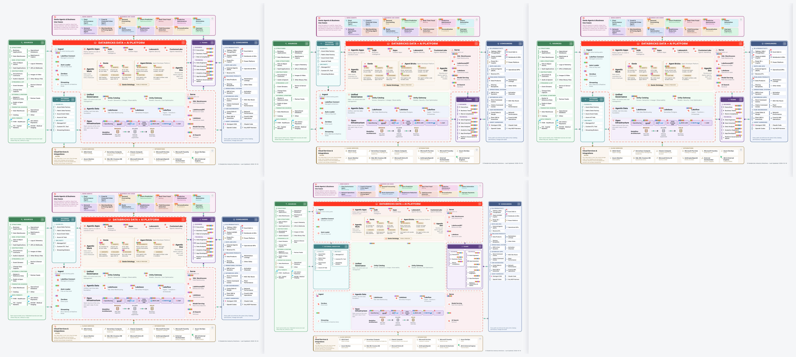

| Shape | Why it exists |
|---|---|
| **Z** | The default. Ingest reaches left over the sources, serving reaches right over the consumers |
| **S** | The Z mirrored, for when the story runs right to left |
| **T** | Both arms on top, for a wide slide with a short middle |
| **T180** | Both arms underneath |
| **H90** | A full I-beam: three rows with split arms and pockets inside the notches, which is what leaves room for the cloud and third-party ingestion to sit *inside* the shape rather than beside it |

Every shape is measured, not eyeballed: the two pockets are equalised to the
taller one, so the arms stay symmetrical to the pixel in all five.

H90 works differently enough from the other four to be worth spelling out. Each
pocket splits into two labelled boxes side by side, Cloud ETL beside 3rd Party
and Business beside Technical, and each box runs its tiles down a single column.
Both pockets sit inside their own arm column rather than spanning the middle, so
the crossbar of the I stays clear, and the governance band renders there instead
of in the lower block: the narrow middle of the shape carries the platform's
control plane rather than being a spacer. The arms are wider here than in the
other shapes to fit those boxes, and the design canvas is wider to match, which
is free because the fit in this shape is bound by height rather than width.

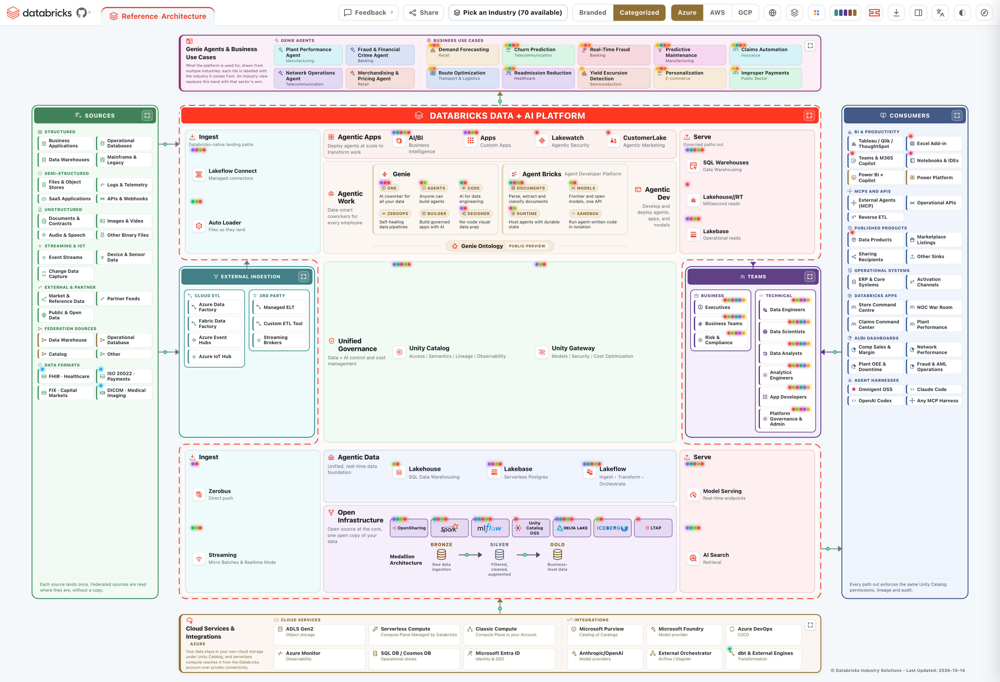

### Palette: thirteen schemes, solved rather than picked

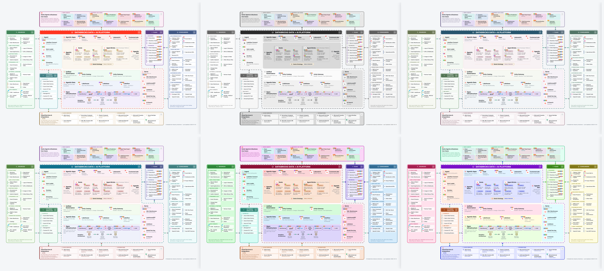

| Group | Palettes |
|---|---|
| **Neutral** | Spectrum (default), Mono (print safe), Muted (low chroma), Nordic (cool calm) |
| **Coloured** | Ocean (analogous), Earth (warm neutral), Sunset (warm shift), Berry (cool warm) |
| **Loud** | Solid (filled), Jewel (deep), Vivid (projector), Pop (playful), Neon (maximum) |

`tools/palgen.py` generates all of them. For every zone hue it walks lightness
until four values clear WCAG AA against the surface each one actually sits on,
in both themes: the zone fill, the chip tile inside it, the border, and the ink
on top. Nothing here is hand-picked, which is why Neon is legible and Mono
survives a black and white printer.

Spectrum keeps the chips white so the reference reads as a document. Every other
palette tints the chips too, so a palette choice is visible in every box rather
than in the labels alone.

### Stage: filter by release stage

| Stage | |
|---|---|
| GA | Available now |
| Public Preview | |
| Beta | |
| Private Preview | |
| Coming soon | |

Each row carries the number of boxes it would show, and switching a stage off
removes those boxes from the platform, closes the gap and re-traces the ring.
Unstaged boxes always stay. An `st` value the app does not recognise is treated
as unstaged rather than quietly filed as available, because the conservative
reading is the honest one in front of a customer.

### Region: what each region can run

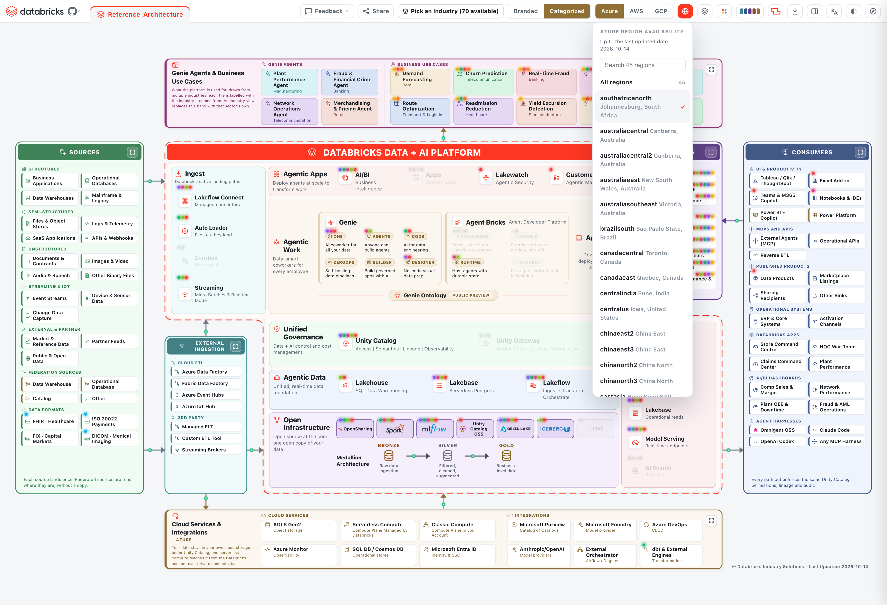

Pick a region in the **Region** menu and every product that region cannot run yet
dims on the board; the rest stay as they are, and *All regions* clears the
filter. The menu lists the regions of the cloud on screen, so switching cloud
switches the list, and it is searchable by region code or location.

The data comes from two public Databricks documentation pages per cloud, the
supported regions and the features with limited regional availability, which
`tools/scrape_regions.py` reads into `resources/regions.json`. A product counts as
available in every supported region unless the docs publish the product itself as
region-limited, so the board never shows a restriction the docs do not.
`tools/regiongate.py` checks the data against the live pages before a release.

Each product's panel carries the same answer as a line, *Available in all N
regions* or *Available in N of M regions* with the region codes listed, and the
line links to the documentation page it came from. A region code in that list
switches the board to that region. The Region and Stage menus both say when the
data was last refreshed, and so does the credit in the board's corner.

### Highlights: what is behind each box

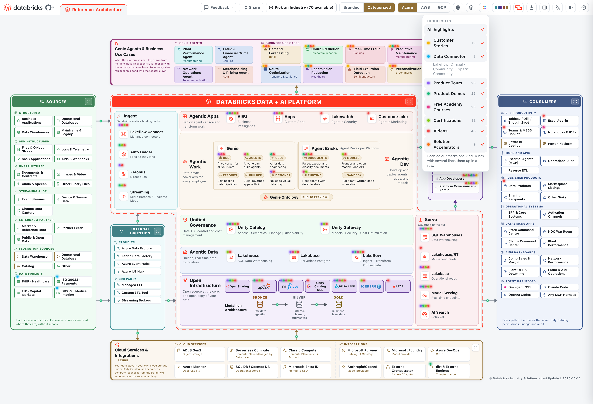

The **Highlights** menu switches glowing dots on in the corners of the boxes, one
colour per kind of resource:

| Kind | What the box carries |
|---|---|
| **Customer Stories** | A Databricks customer story that uses it |
| **Data Connector** | A Lakeflow connector, official or community, or a community Spark connector |
| **Product Tours** | An interactive tour from the Databricks demo center |
| **Product Demos** | A hands-on demo or tutorial |
| **Free Academy Courses** | Free Databricks Academy courses, sorted from beginner to advanced |
| **Certifications** | A Databricks certification, accreditation or badge that covers it |
| **Videos** | Curated videos from the official Databricks YouTube channel |
| **Solution Accelerators** | A Databricks solution accelerator built on it |

Every kind is on by default, each row shows how many boxes carry it, and a box
with several lines its dots up in a row. The dots stay out of the downloaded
images and decks. The certifications come from the public catalogue at
databricks.com/learn/certification through `tools/build_certifications.py`, which
checks every product pairing against the certification's current exam guide and
fails the build when a guide stops naming the product.

### Download

| Format | What you get |
|---|---|
| **PDF** | A cover with the title, the industry and cloud, the sentence the board leads with, and clickable links to the exact live board and to the industry's data model; an index page listing the sections; the architecture as a pixel-exact image of the board on a transparent background, in the current theme and palette; then four section breaks, each with one page per item, *Use Cases* (problem, beneficiary, build, components, story links), *Genie Agents* (the domain it serves, the data it reads, the teams and its top questions), *AI/BI Dashboards* (the KPIs it tracks and the teams that run on it) and *Databricks Apps*; then a closing page linking to the platform and the live board. All in the theme on screen and in Branded or Categorized names to match the board |
| **PowerPoint** | The same pages, as native slides: a cover, an index slide, a board slide carrying a pixel-exact image of the board on a transparent background, then the *Use Cases*, *Genie Agents*, *AI/BI Dashboards* and *Databricks Apps* sections a slide per item, and a closing slide. An *Editable Architecture* appendix follows: a break slide, then the board again as grouped native shapes you can ungroup and edit in PowerPoint, Keynote or Google Slides. The deck follows the theme and the Branded/Categorized choice on screen, so a categorized dark board exports a categorized dark deck |
| **PNG** | 2x raster of the current view on a transparent background |
| **GIF** | A looping animation, 1400px wide, twelve frames, that keeps the travelling dashes and the platform ring moving. Roughly 200 KB, because only the moving pixels are stored per frame, in the palette and theme on screen. The background is transparent wherever no frame paints |
| **HTML** | A standalone copy of the page with your current choices baked in, which opens anywhere with no server |

**Edit in another app.** These downloads rebuild the current view as grouped, editable shapes instead of a picture. Every zone, group box and tile is a group you can ungroup; labels are real text, arrows are connectors, product logos are crisp images and each tile keeps its Databricks link. The other app draws text in its own fonts, so labels can shift slightly. For PowerPoint, the deck's appendix carries the same editable board.

| Format | Opens in |
|---|---|
| **draw.io** (`.drawio`) | draw.io on the web, desktop, Confluence and Jira; imports into Lucidchart |
| **Visio** (`.vsdx`) | Visio; imports into Miro, Lucidchart, draw.io and OmniGraffle |
| **SVG** (`.svg`) | Figma, Illustrator and Inkscape, as editable vector layers and text |
| **Excalidraw** (`.excalidraw`) | Excalidraw, as grouped elements with editable text |

Every download is named for what is in it, so a folder of them stays readable:
`databricks-airlines-reference-architecture.pdf`, and `-platform` on the end when
the platform zoom is on. The board carries
*(C) Databricks Industry Solutions* and the date its data was last updated in its
bottom right corner, on screen and in every export.

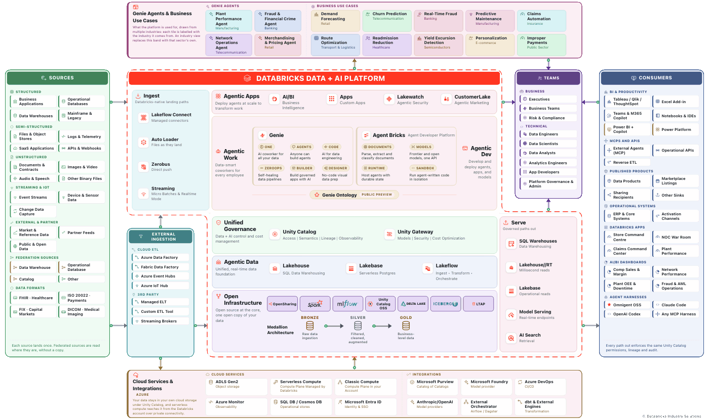

### Language: sixteen translations

The board content translates into sixteen languages: English, French, Spanish,
Chinese, Arabic, Hindi, German, Portuguese, Dutch, Japanese, Italian, Swedish,
Korean, Danish, Finnish and Hebrew. Arabic and Hebrew turn the whole layout
right-to-left. What translates is the content a reader is there to understand,
the zone labels, the captions, the use cases, the team and Genie Agent
descriptions; what does not is the toolbar and menus, which stay in English, and
product and brand names, which are the same word in every language. Each language
is a folder of JSON under `translations/`, fetched only when it is picked, so the
first load stays small and a language a reader never opens is never downloaded.
The choice carries into the PDF and PowerPoint exports too, so a board read in
Japanese exports a Japanese deck.

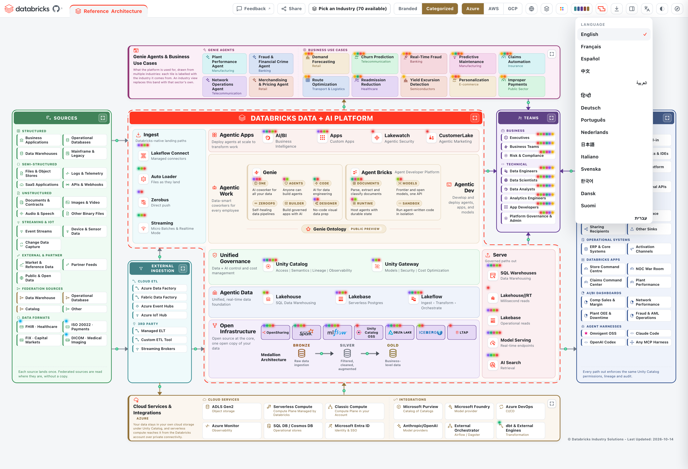

### Share: a preview card per industry

The **Share** control posts the board to LinkedIn, X, Facebook, Reddit, Hacker
News, WhatsApp, Telegram or email, or copies the link, which goes straight to the
industry and cloud on screen. Every
industry carries its own Open Graph preview image and a small share stub per
cloud, so when one of those links is pasted into Slack, Teams, an email or a
social feed it unfurls with a picture and a title tailored to that industry,
rather than a bare URL. The images and stubs are generated, one per industry and
one per industry-and-cloud, and live under `assets/og/` and `share/`.

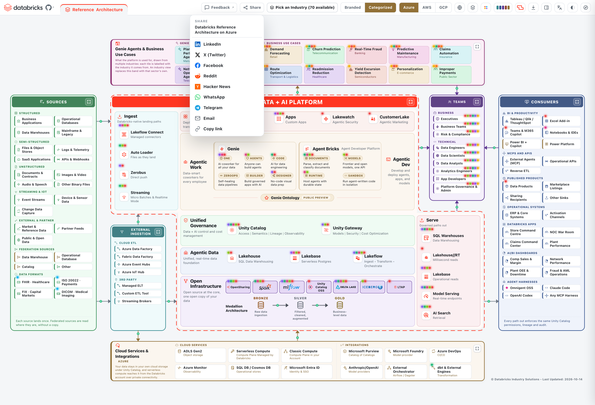

---

## The detail drawer

Click any box.

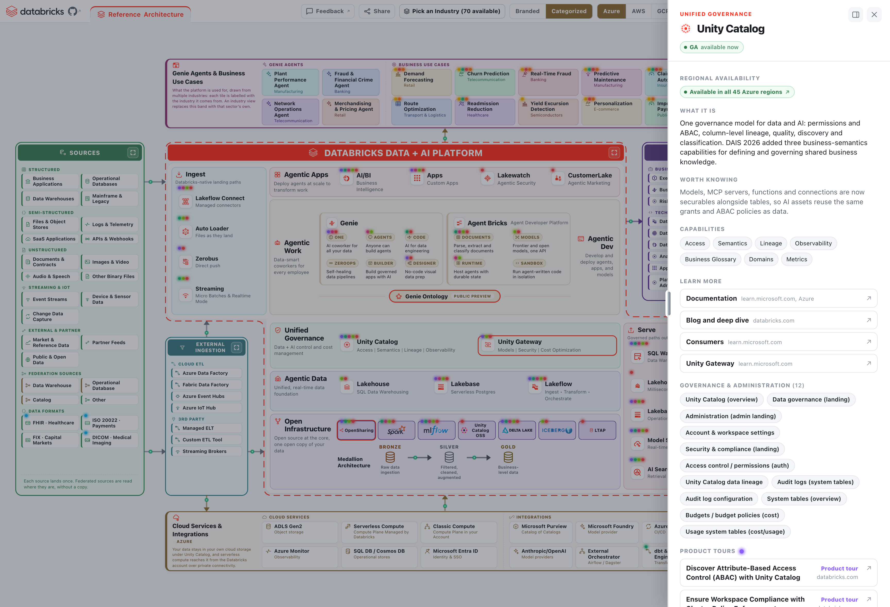

| Section | |
|---|---|
| **Stage badge** | GA, Beta or the preview the box is in |
| **Regional availability** | Whether the product runs in every region of the cloud on screen, or in which ones, linked to the docs page that says so. Each region code switches the board to that region |
| **What it is** | Plain English, no marketing |
| **Worth knowing** | The thing the name does not tell you |
| **Capabilities** | What it actually does |
| **Learn more** | Cloud-specific documentation, the cloud vendor's own page, the product page, and a blog or deep dive |
| **Documentation catalogue** | For the larger products, their main documentation pages, grouped, such as the governance and administration pages under Unity Catalog |
| **Product tours and demos** | Interactive tours and hands-on demos from the Databricks demo center |
| **Free Academy Courses** | The free Databricks Academy courses that teach it, beginner first |
| **Certifications** | The Databricks certifications, accreditations and badges that cover it, with their level |
| **Videos** | Curated videos from the official Databricks YouTube channel |
| **Related** | The boxes it touches, which highlight on the diagram and are one click away |

Every chip in the panel is a link: to the box on the board when there is one,
otherwise to the Databricks page for it, so there are no dead labels. Following a
chip remembers where you came from, and a back control in the panel's corner walks
you back. Every link goes to a Databricks page; the one exception is a data
format, which links to its standards body.

A Teams tile reads a little differently, because a team is not a product: the
panel names the team, says what it is accountable for, lists its sub-personas and
what each one cares about, and then lists the platform surfaces it actually works
in with one line each on what it uses them for, alongside the use cases the team
is interested in. Those surface and use-case names are clickable, so the panel is
a route into the diagram rather than a description beside it. The panel also
gathers the learning track, the certifications, and the customer stories, demos
and videos that matter to that team, from the products it uses and the use cases
it drives.

A use case tile carries its own story: the problem it solves, who benefits (a
team from the diagram, clickable), how it is built, the architecture components
it uses (each clickable), and links to Databricks customer stories where they
exist. On every board the use cases that have a story are shown first.

A source tile is enriched beyond its name: what the system does, who uses it, and
the data it produces, split into **Batch** and **Streaming**, each stamped with
the data shape (structured, semi-structured or unstructured), a typical volume
and a cadence. So a reader can see not just that a source feeds the platform but
what shape and how much data lands, and how often. A data-format tile, such as
FHIR or ISO 20022, names its standard and links to the standards body's own page.

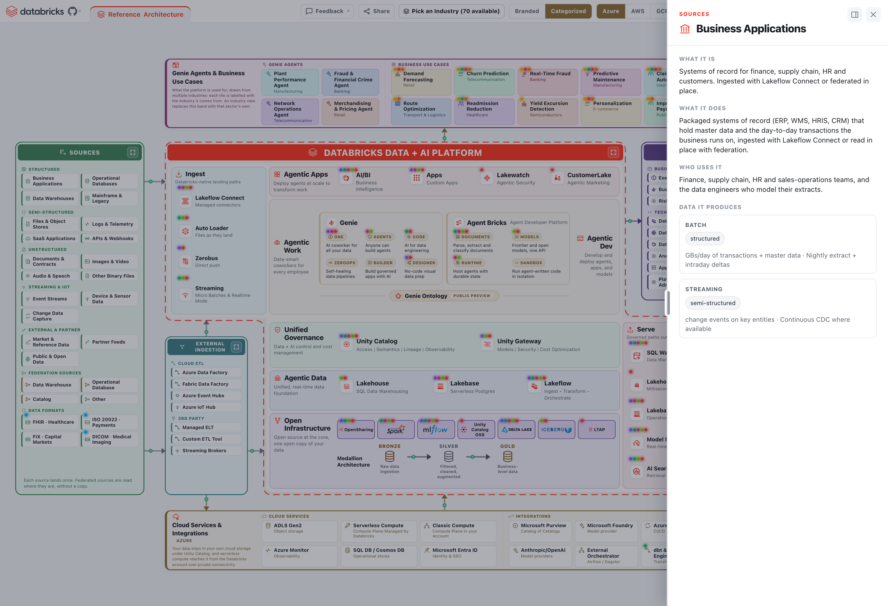

A Genie Agent tile carries the domain it serves as its subtitle (on the reference
board, the industry it comes from), the same way a use case does, then the
governed data sources it reads (clickable
chips), the teams it serves, and the top questions it answers in plain language.
An AI/BI Dashboard tile names the KPIs and metrics it tracks and the teams that
run on it. Both live in their own bands, Genie Agents beside the use cases above
the platform, dashboards among the consumers, so the board says who asks the
questions and who reads the answers, not just where the data goes.

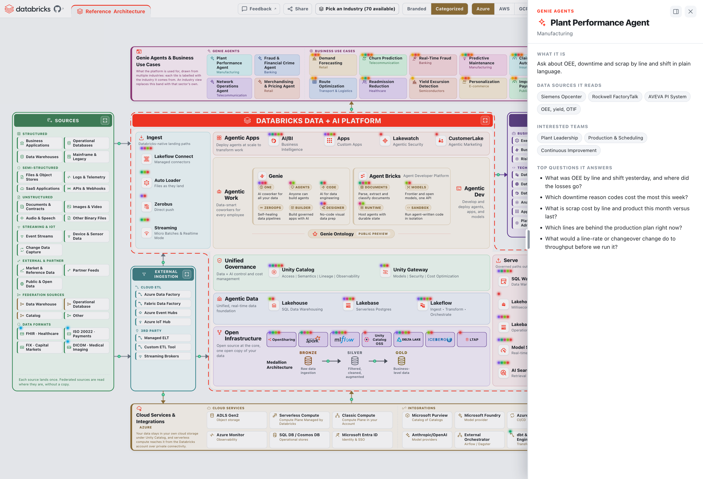

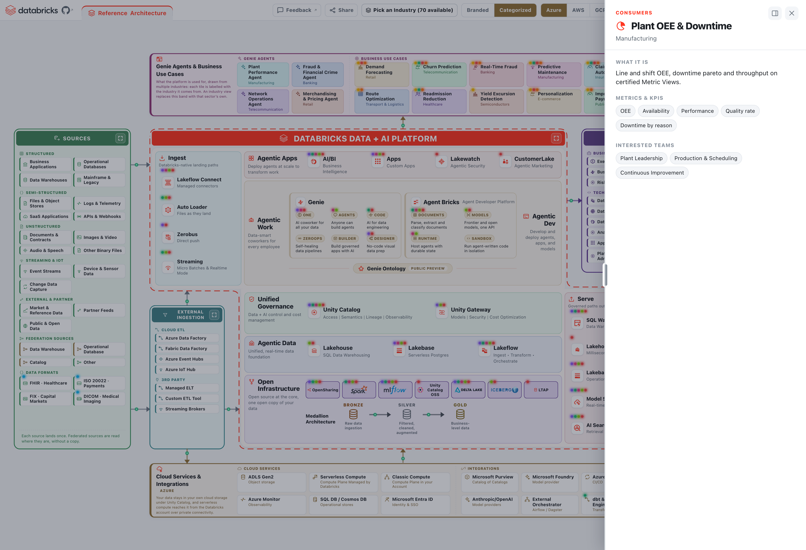

The three medallion layers open the data model for the industry on screen, so on
an airline board that is the
[airlines model](https://github.com/databricks-industry-solutions/lakehouse-industry-data-models/tree/main/data-models/airlines)
rather than the catalogue root. They also open the
[launch blog](https://www.databricks.com/blog/jumpstart-your-data-modeling-databricks-industry-data-models),
the
[Vibe Data Modeling blog](https://www.databricks.com/blog/reimagining-data-modeling-lakehouse-introducing-vibe-data-modeling)
and the
[agent that generates the models](https://github.com/databricks-industry-solutions/lakehouse-industry-data-models/tree/main/model-agent).

Every box is reachable by keyboard, and Escape closes the drawer.

---

## Tabs

The **Reference Architecture** tab is pinned and cannot be closed. **Edit**
clones the board on screen into a tab of your own: an independent working copy
that carries its own industry, cloud, palette, shape, stage and platform zoom,
so you can retarget and export it without touching the reference. One clone at a
time, so Edit steps aside while a clone is open and returns the moment you close
it. Rename a tab by double-clicking its name, and close it with its own x.

What is remembered between visits: theme, palette, platform shape, stage filter,
region, highlights, language, the Branded or Categorized choice, and your tabs,
including which one was open. The cloud switch and Platform-only
start fresh on every load, because both are how you frame one conversation
rather than a preference.

---

## AI Architecture Assistant (`app/ai/`)

A chat-driven sub-app that lets you describe a customer or use case and receive a new,
editable, persisted tab containing a tailored architecture, without touching the
reference board. The reference board stays live and unmodified; the generated tab is its
own independent copy.

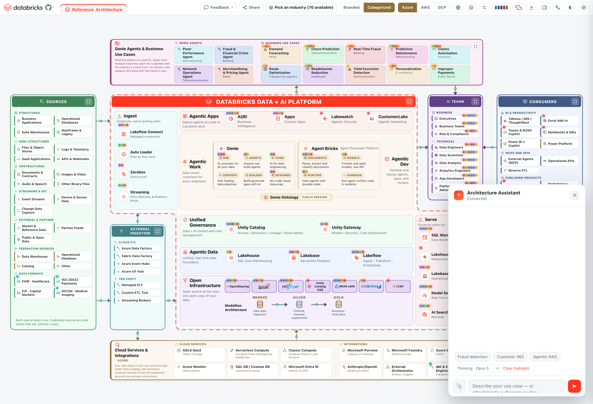

**What it does.** Type a description in the chat input, or attach or paste a whiteboard
photo, a screenshot, a PDF or a text file. The assistant detects the best-fit industry
from what you gave it, generates a tab tailored to that use case, and opens it with edit
mode pre-enabled. The generated tab keeps the whole Databricks platform on screen and dims
the products this use case does not use, while Sources and Consumers are trimmed to the
relevant ones; a source, team or consumer from your diagram that matches nothing in the
catalogue is added as a box with its own label. The tab persists between reloads. The
reference board is never switched or mutated by industry detection.

**Model choice.** A menu just above the chat input picks the tier: *Fast*, *Balanced* or
*Thinking* (the default), which the backend maps to the newest Claude Haiku, Sonnet and
Opus serving endpoints the workspace offers.

**Two-phase, industry-grounded selection.** Phase 1 grounds the model on the live
generic board catalog and identifies the best-fit industry. Phase 2, only when a known
built industry matches, loads that industry's YAML template and re-runs component
selection against that industry's own catalog, so industry-specific atoms (for example,
banking's core-banking systems or healthcare's EHR vendors) are included in the output.
Generic descriptions skip Phase 2.

**Industry type-ahead chip.** As you type in the chat input, matching industries surface
as chips. Picking one switches the Reference board to that industry immediately; it does
not generate a tab, it is a separate shortcut to the board's existing industry switch.

**Editing a generated architecture.** Every generated tab opens with edit mode on (the
`✎ Editing: on` toggle in the chat header), so it is a working draft you can shape by
hand, not a fixed output. Click any component on the board to edit it in the drawer:
change its **title**, its **caption / description line**, the **detail text** that
explains what it does in this architecture, and its **capabilities** (comma-separated
tags), or **delete** it outright. Double-click a tab's name to **rename** it. Edits are
scoped to that tab and persist between reloads; the toggle is per-tab, so switching to the
Reference board turns editing off and the reference stays read-only. The AI's per-component
usage notes ride along too: hover any component on a generated tab to see why the assistant
included it. Boxes the assistant added are highlighted by default; the edit panel's
**Highlight / Dim** toggle, or a plain click on a dimmed box, changes what stands out, and
**Clear highlight** removes the overlay.

**One board, no fork.** `app/ai/app.py` serves the same `app/index.html` the static site
publishes and injects the assistant's `app/ai/ai.css` and `app/ai/ai.js` at request time,
so the assistant always runs on the current board with the shared `app/architectures/*.yaml`
templates, `app/resources/*.json` and `app/translations/*`. A fix to the board reaches the
assistant with no port, and any new industry template added to `app/architectures/` is
available to it with no code change.

**Backend.** `app/ai/app.py` is a FastAPI server (not the stdlib `main.py`). It serves the
composed page and the shared `app/` folders, exposes `/health`, `/models` and
`POST /generate {system,user,model}->{text}`, and calls a Databricks-hosted Claude
Foundation Model serving endpoint with the app's injected WorkspaceClient OAuth identity, so
no API key is required or stored. The model tiers are discovered from the workspace's
serving endpoints, with `databricks-claude-haiku-4-5`, `databricks-claude-sonnet-5` and
`databricks-claude-opus-5` as fallbacks (override with `FAST_ENDPOINT`, `SERVING_ENDPOINT`
and `THINKING_ENDPOINT`), and calls go through an AI Gateway when `AI_GATEWAY_URL` is set.
Both servers, this one and `main.py`, send a Content-Security-Policy and refuse to be framed.

---

## MCP server (`app/mcp/`)

The same 70 industry reference architectures are also exposed as an **MCP server**, so
an agent — Claude Code, Claude Desktop, or any Model Context Protocol client — can list,
fetch, and search them programmatically, without the browser app.

It reads `app/architectures/*.yaml` and `app/resources/*.json` directly — the same shared
templates the web app uses — so a new industry dropped into `architectures/` shows up
through the tools with no code change.

**Tools**

| Tool | Args | Returns |
|------|------|---------|
| `list_industries` | none | `[{id, name, description}]` for all 70 industries |
| `get_architecture` | `industry_id` | one industry's full architecture (sources, cloud integrations, pipelines/medallion, consumers, agent use cases) |
| `search_architectures` | `query` | `[{id, name, matches}]` — industries whose name/description/components mention the query |
| `list_resources` | `kind` | one of the shared maps: `accelerators`, `connectors`, `links`, `references` |

**Run it**

```bash
cd app/mcp
python3 -m venv .venv && .venv/bin/pip install -r requirements.txt
.venv/bin/python server.py            # stdio transport
```

**Register with Claude Code** (tools then appear as `mcp__arch-explorer__*`):

```bash
claude mcp add arch-explorer -- "$(pwd)/.venv/bin/python" "$(pwd)/server.py"
```

Or add to a project `.mcp.json`:

```json
{ "mcpServers": { "arch-explorer": { "command": "/abs/path/app/mcp/.venv/bin/python",
                                     "args": ["/abs/path/app/mcp/server.py"] } } }
```

**Use it.** Just ask in natural language — the client's own model calls the tools and
grounds its answer in the live templates:

- *"List the industry reference architectures."* → `list_industries`
- *"Show me the banking reference architecture."* → `get_architecture("banking")`
- *"Which industries cover fraud detection?"* → `search_architectures("fraud")`
- *"What Lakeflow connectors are available?"* → `list_resources("connectors")`
- *"Design a real-time fraud architecture for a retail bank"* → the model searches the
  templates, pulls the closest industry, and synthesises a tailored architecture from it.

Retrieval only — it serves the templates as-is. Generating a tailored architecture from a
free-text description is done by the calling model, not a server-side LLM tool. See
`app/mcp/README.md` for details.

---

## How to deploy

### Option 1: the installer notebook (recommended)

The repository ships an installer that creates the Databricks App and deploys
the diagram into it. It needs no catalog, no SQL warehouse and no data access:
the app serves one static file, and its service principal reads nothing.

1. In your Databricks workspace, choose **Workspace -> Create -> Git folder**
   and clone this repository.
2. Open **`app-installer.ipynb`** from inside that folder.
3. **Run All.** The defaults are correct for this path.
4. When it finishes it prints a link. The app also appears under
   **Compute -> Apps -> idea**.

Run All launches the install as a **tagged Databricks job**, prints the run URL,
waits for it, then surfaces the app link. The job carries `dbx_reference_architecture_agent_installer_*`
tags (`app`, `kind`, `version`, `status`), so its serverless spend is
attributable in `system.billing.usage`, the same pattern the vibe-modelling
agent installer uses. If the running identity cannot create a job, the notebook
deploys inline instead, so the install still works, just untagged.

A Databricks App has no custom-tag field of its own, so the app's own ongoing
serverless spend is attributed through a **serverless usage policy**: set widget
4 to a policy id and the installer attaches it on create, and its tags flow to
`system.billing.usage`.

Widgets, if you want to change something:

| Widget | Default | What it does |
|---|---|---|
| `01_app_name` | `idea` | Name of the Databricks App. Lowercase letters, digits and dashes |
| `02_source` | Beside this notebook | Where the app files come from. Leave it alone when running from a Git folder |
| `03_github_repo` | this repo | Only read when `02_source` is *Download from GitHub* |
| `04_usage_policy_id` | empty | Optional serverless usage policy id to attribute the app's spend. Blank skips it |

Choose **Download from GitHub** if you imported only the notebook rather than
cloning the repository. It pulls the archive over HTTPS and writes the `app/`
folder into your workspace home. Two things have to be true for it to work: the
workspace needs outbound internet access, and the repository has to be readable
without a token, which a public repository is. A private repository returns 404
to the anonymous archive request, and some locked-down workspaces have no
outbound internet either, so use the Git folder path in both of those cases.

To upgrade later: **Pull** on the Git folder, then Run All again. The installer
reuses the existing app and redeploys it.

**Prerequisites**

- Databricks Apps enabled on the workspace (*Compute -> Apps*)
- Permission to create apps, which workspace admins have by default

**Cost.** The app runs on its own small serverless compute. Stop it from
*Compute -> Apps* when you are not showing it.

### Option 2: the CLI

If you would rather not run a notebook:

```bash
# 1. put the whole app folder in the workspace (boards, translations,
#    resources, assets and vendor all have to come along, not just index.html)
databricks sync app "/Workspace/Users/$USER/idea/app"

# 2. create the app and deploy into it
databricks apps create idea
databricks apps deploy idea --source-code-path "/Workspace/Users/$USER/idea/app"
```

Redeploying after a change is the same two steps without `apps create`.

### Option 3: no Databricks at all

Serve the folder with the bundled static server and open the printed URL:

```bash
cd app && python3 main.py     # http://localhost:8000
```

The boards and translations are fetched at runtime, so serve the folder rather
than opening `index.html` straight off the filesystem, which browsers block
`fetch()` on. To hand someone a single file that opens with no server at all, use
the **HTML** download from the toolbar: it bakes the current board in.

---

## Repository layout

```
app-installer.ipynb        Databricks App installer, Run All
app/
  index.html               the board: markup, styles, logic, logos; lazy-loads the rest
  arch_schema.js           the YAML board-descriptor schema, shared by the app and the tools
  industry_icons.js        the line-art industry glyphs
  main.py                  static server for Databricks Apps, standard library only
  app.yaml                 Databricks App entry point
  architectures/           one YAML board per industry (70) plus manifest.json, fetched on demand
  resources/               reference tables as JSON: accelerators, connectors, links, references,
                           regions, Academy courses, certifications and platform doc catalogues
  translations/            one folder per language (English source plus fifteen), fetched on demand
  assets/                  the Databricks mark, the default share cover, and per-industry cards (assets/og/)
  share/                   per-industry, per-cloud share stubs (280) that unfurl a preview card
  vendor/                  js-yaml, the one bundled dependency
  ai/                      the AI Architecture Assistant: app.py serves the shared board and injects
                           ai.css and ai.js (see app/ai/README.md)
  mcp/                     MCP server exposing the reference architectures as tools (see app/mcp/README.md)
docs/                      the screenshots and the animated export used above
tools/                     generators and gates: palettes (palgen.py), product marks (markgen.py),
                           the installer (build_installer.py), region data (scrape_regions.py), the
                           Academy, certification and demo catalogues (build_academy.py,
                           build_certifications.py, build_demos.py), the README screenshots
                           (shot.py), and the region, height, layout, link, i18n, export,
                           performance, share and YAML checks run before a board ships
```

---

## How it is built

**A static folder, no build.** `app/index.html` carries the markup, the styles,
the logic and the logos, and loads everything else as data: the seventy
industry boards are YAML descriptors under `architectures/`, indexed by
`architectures/manifest.json` and fetched on demand; the reference tables
(accelerators, connectors, links, customer stories, regions, Academy courses,
certifications and doc catalogues) are JSON under `resources/`;
and each language is a folder of JSON under `translations/`, fetched only when it
is picked. The one bundled dependency is `vendor/js-yaml.min.js`, which parses the
board descriptors. There is still no bundler and no package manager, but because
the boards and translations are fetched at runtime the folder is *served* rather
than opened from a `file://` path, which browsers block `fetch()` on. The **HTML**
download bakes the current board in, so that single file does open anywhere with
no server.

**The model is data.** Each board is a plain `ARCH` object the zones render from,
authored as a readable YAML descriptor and loaded on demand. The reference
material behind each box is a separate table on purpose: the board is what a user
edits, saves and exports, while the product descriptions, stages and links are
fixed facts that have no business being editable. You can export any board as
YAML from the Download menu, edit it offline, and import it back to open your
version in a new tab.

**Exports are written by hand.** The PDF, PowerPoint and GIF writers are in the
file: object tables and cross-reference offsets for the PDF, the parts and
relationships of an Office package for the PPTX, both carrying the cover, an
index, the board, then a page or slide per item across the Use Cases, Genie
Agents, AI/BI Dashboards and Databricks Apps sections, and a closing slide, with
clickable links throughout. The board image in both is transparent, which in the
PDF means a soft mask the writer emits itself. The PPTX then adds an appendix
with the board as editable shapes. Every section is laid out from the same tile data the
on-screen drawer reads, through one `deckSections()` source of truth, so the deck
and the drawer cannot drift, and each tile is relabelled Branded or Categorized
and picks up the live theme, so a categorized dark board exports a categorized
dark deck. Pulling in a library for each format would be more code than the
formats need, and would put the exports behind a network fetch that a workspace
with no internet egress would fail on. The draw.io, Visio, SVG and Excalidraw
writers and the deck's editable appendix share one walk of the live board,
`collectBoard()`, so all five carry the same shapes, groups and links.

**Colours are solved, not chosen.** `tools/palgen.py` takes a hue recipe per
zone and walks lightness until every foreground clears WCAG AA against the
surface it will actually sit on, in both themes, then emits the CSS.

**The animation survives export.** A raster export freezes every CSS animation,
so a naive GIF would be twelve identical frames. Each connector's travelling dot
is also expressed as a function of a `--dash-t` phase variable, which the GIF
encoder walks one step per frame. Only the moving pixels differ between frames,
and the encoder stores the rest as transparent, which is why twelve frames of a
1400px board fit in about 200 KB.

**Motion rests at idle.** Every dot shares one phase, set from its animation's own
start time, so the flows stay in step after a fit, an export or a wake. After a
minute with no pointer, key or wheel input, or while the tab is hidden, the board
pauses all motion and resumes on the next input; with reduced motion set it stays
still. `tools/perfgate.js` checks that the board does no work at idle and that
boot fetches each file once, in parallel.

**The layout is measured, not tuned.** The board is laid out at a fixed design
width and then scaled to fit, and the two halves of the platform are balanced
after the first measurement and re-measured before the scale is applied. That is
why a shape change, a stage filter and a palette switch all land on the same
symmetrical geometry instead of drifting a few pixels each time.

**Content is written to a measured budget.** Because the board is scaled to fit,
content and type size are the same decision: a zone that grows by one tile
shrinks every label on the board. So the pockets are measured rather than
guessed. `tools/probe.py` injects a probe that clones tiles into a zone until the
board gets taller, which is how the eight-tile Teams pocket is an eight-tile
pocket, and `tools/heightgate.py` holds every industry to it in all five shapes.

---

## Credits

Built by **Ashraf Osman & Amr Ali**.

The Apache Spark, MLflow, Delta Lake, Unity Catalog, Apache Iceberg and Delta
Sharing marks belong to their respective projects and are used to identify those
projects.
